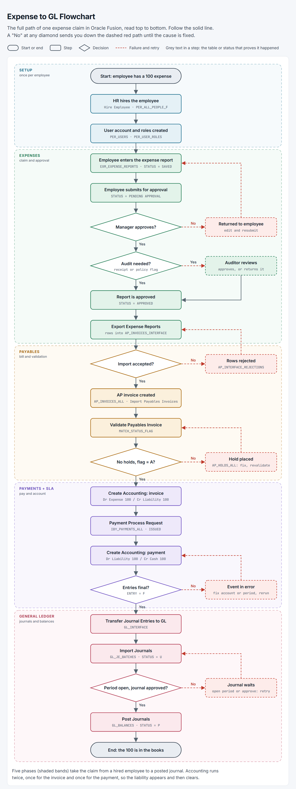
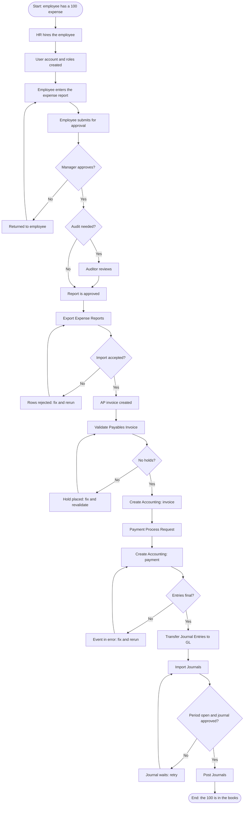

# Oracle Fusion Flows

My study notes for how data moves through Oracle Fusion Cloud, drawn as flowcharts.

The first flow is **Expense to GL**: what happens from the moment an employee has an expense to the moment it is posted in the General Ledger. It is meant for someone learning Fusion Financials (functional side) who wants to see what really happens behind the screens, step by step, with the tables and statuses involved.

## What is in this repo

| File | What it is |
|---|---|
| `README.md` | This page. The flow below is drawn right here, so you can read it on GitHub without opening anything. |
| `flowcharts/expense-to-gl-flowchart.png` | The colored flowchart as a picture. GitHub shows it directly in the README. |
| `flowcharts/expense-to-gl-flowchart.html` | The same colored flowchart as a web page. GitHub only shows its code, so download it and double-click to open it in your browser. |

## The flow in one picture

The picture above is the colored version. The same flow is drawn again below in text form, so you can read or copy it.

Read it top to bottom. A diamond is a yes or no question. A "No" sends you to a fix, then back to retry the step.

## The steps in plain English

| # | What happens | Fusion job or screen | Main tables | Done when |
|---|---|---|---|---|
| 1 | HR hires the person | Hire Employee | `PER_ALL_PEOPLE_F`, `PER_ALL_ASSIGNMENTS_M` | Assignment is `ACTIVE` |
| 2 | A login and roles are created | Autoprovisioning | `PER_USERS`, `PER_USER_ROLES` | `ACTIVE_FLAG = Y` |
| 3 | The employee enters the expense report | Expenses | `EXM_EXPENSE_REPORTS`, `EXM_EXPENSES`, `EXM_EXPENSE_DISTS` | Status `SAVED` |
| 4 | The employee submits it | Expenses | `EXM_EXPENSE_REPORTS` | Status `PENDING APPROVAL` |
| 5 | The manager approves (and an auditor, if needed) | Approval workflow | `EXM_EXPENSE_REPORTS` | Status `APPROVED` |
| 6 | The approved report is sent to Payables | Export Expense Reports | `AP_INVOICES_INTERFACE`, `AP_INVOICE_LINES_INTERFACE` | Rows land in the interface tables |
| 7 | Payables turns those rows into a real invoice | Import Payables Invoices | `AP_INVOICES_ALL`, `AP_INVOICE_LINES_ALL`, `AP_INVOICE_DISTRIBUTIONS_ALL` | Interface status `PROCESSED` |
| 8 | The invoice is checked | Validate Payables Invoice | `AP_INVOICES_ALL`, `AP_HOLDS_ALL` | `MATCH_STATUS_FLAG = A`, no holds |
| 9 | The invoice is turned into an accounting entry | Create Accounting | `XLA_EVENTS`, `XLA_AE_HEADERS`, `XLA_AE_LINES` | Entry status `F` (final) |
| 10 | The employee is paid | Payment Process Request | `IBY_PAYMENTS_ALL`, `AP_CHECKS_ALL` | Payment status `ISSUED` |
| 11 | The payment is turned into an accounting entry | Create Accounting | `XLA_AE_HEADERS`, `XLA_AE_LINES` | Entry status `F` (final) |
| 12 | Both entries are sent to the ledger | Transfer Journal Entries to GL | `GL_INTERFACE` | Transfer status `Y` |
| 13 | Journals are created from them | Import Journals | `GL_JE_BATCHES`, `GL_JE_HEADERS`, `GL_JE_LINES` | Batch status `U` (unposted) |
| 14 | Journals are posted and balances update | Post Journals | `GL_BALANCES` | Batch status `P` (posted) |

## Why accounting runs twice

Create Accounting runs once for the invoice and once for the payment.

- Invoice: debit Expense 100, credit Payables liability 100. The company now owes the employee.
- Payment: debit Payables liability 100, credit Cash 100. The debt is paid.

After both, the liability is back to zero. Only the expense and the cash movement stay in the books.

## Where things usually get stuck

- **Report never reaches Payables:** it is not `APPROVED` yet, or the employee is not set up as a supplier.
- **Invoice cannot be paid:** `MATCH_STATUS_FLAG` is not `A`, or there is an open hold in `AP_HOLDS_ALL`.
- **Nothing in the ledger:** the accounting event is in error, or `GL_TRANSFER_STATUS_CODE` is still `N`. Look for an invalid account or a closed period.
- **Journal not posted:** the period is closed, or the journal is waiting for approval.

## How accurate is this?

I wrote the job names, table names, column names and status codes from my own working knowledge of Oracle Fusion. I have **not** checked them against Oracle's documentation or a real Fusion environment. The export job name (step 6) is the one I am least sure about, because names can change between releases.

Before relying on any name, check it in Oracle's *Tables and Views for Financials* guide or in your own environment, and fix it here if it is different.

## Ideas for next flows

- Receivables: customer invoice to receipt to GL
- Procure to Pay: requisition to purchase order to receipt to invoice
- Fixed Assets: asset addition to depreciation to GL
