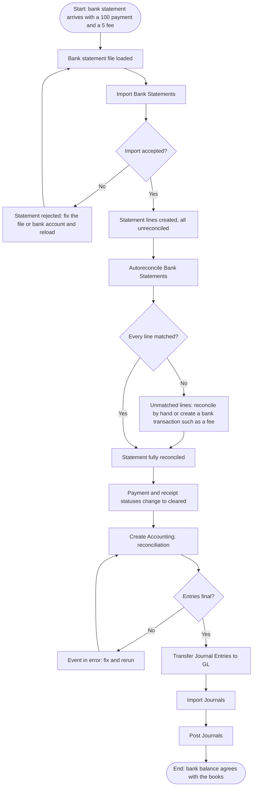

# Cash Management: Bank Statement to GL

**What this flow covers:** the bank sends a statement, the company matches every line on it to its own records, and the result reaches the books. When it is finished, the bank's balance and the company's cash balance agree.

**Modules involved:** Cash Management, Payables (payments), Receivables (receipts), Subledger Accounting (SLA), General Ledger (GL).

**Example used:** a bank statement with a 100 payment to a supplier and a 5 bank fee.

Read the flowchart top to bottom. A diamond is a yes or no question. A "No" sends you to a fix, then back to retry the step.

## The steps in plain English

| # | What happens | Fusion job or screen | Main tables | Done when |
|---|---|---|---|---|
| 1 | The bank statement file is loaded | Load Bank Statement Data | `CE_STATEMENT_HEADERS_INT`, `CE_STATEMENT_LINES_INTERFACE` | Rows are in the interface tables |
| 2 | The statement is imported and checked | Import Bank Statements | `CE_STATEMENT_HEADERS`, `CE_STATEMENT_LINES` | Statement and lines created |
| 3 | Lines are matched to the company's own records | Autoreconcile Bank Statements | `CE_STATEMENT_LINES`, `AP_CHECKS_ALL`, `AR_CASH_RECEIPTS_ALL` | Matched lines show as reconciled |
| 4 | Lines that did not match are handled | Manual Reconciliation, bank statement transaction rules | `CE_STATEMENT_LINES` | No unreconciled lines left |
| 5 | The matched payments and receipts are marked as cleared | Updated by reconciliation | `AP_CHECKS_ALL`, `AR_CASH_RECEIPTS_ALL` | Payment cleared or reconciled, receipt cleared |
| 6 | The reconciliation is accounted | Create Accounting | `XLA_EVENTS`, `XLA_AE_HEADERS`, `XLA_AE_LINES` | Entry status `F` (final) |
| 7 | Entries go to the ledger | Transfer Journal Entries to GL | `GL_INTERFACE` | Transfer status `Y` |
| 8 | Journals are created and posted | Import Journals, Post Journals | `GL_JE_BATCHES`, `GL_JE_LINES`, `GL_BALANCES` | Batch status `P` (posted) |

## What gets matched

Autoreconcile compares each statement line with the company's own records, using the amount, date and reference.

| Statement line | Matched against | Result |
|---|---|---|
| 100 paid out | A payment issued earlier in Payables | The payment becomes cleared |
| Money received | A receipt created in Receivables | The receipt becomes cleared |
| 5 bank fee | Nothing, because the company has no record of it yet | Unmatched: create a bank transaction for the fee |

## The accounting entries

| Event | Debit | Credit |
|---|---|---|
| Bank fee, created during reconciliation | Bank charges expense 5 | Cash 5 |
| Payment cleared, only if the payment method uses a cash clearing account | Cash clearing 100 | Cash 100 |

If your setup does not use a cash clearing account, the cash was already reduced when the payment was made, and clearing the payment creates no new accounting entry. Check which way your setup works.

## Where it usually gets stuck

- **Statement will not import:** the file format is wrong, or the bank account in the file is not set up in Fusion.
- **Lines will not match:** the amount, date or reference differs from the payment or receipt, or the payment was never issued.
- **Fee or interest left over:** the bank charged something the company has no record of. Create a bank transaction for it.
- **Nothing in the ledger:** the reconciliation accounting event is in error, or the transfer status is still `N`.

## Accuracy note

Job names, table names, column names and status codes are written from working knowledge of Oracle Fusion. They have not been checked against Oracle's documentation or a real environment. Reconciliation accounting (step 6) and exact status values are the parts I am least sure about, so verify those first.

[Back to all flows](../README.md)
