# Expense to GL

**What this flow covers:** an employee spends money, claims it back, gets paid, and the amount ends up in the company's books.

**Modules involved:** HCM (the employee and login), Expenses, Payables, Payments, Subledger Accounting (SLA), General Ledger (GL).

**Example used:** an employee claims a 100 hotel bill.

Read the flowchart top to bottom. A diamond is a yes or no question. A "No" follows the dashed red path to a fix, then back to retry the step.

[Open the flowchart full size](expense-to-gl.svg)

## The steps in plain English

| # | What happens | Fusion job or screen | Main tables | Done when |
|---|---|---|---|---|
| 1 | HR hires the person | Hire Employee | `PER_ALL_PEOPLE_F`, `PER_ALL_ASSIGNMENTS_M` | Assignment is `ACTIVE` |
| 2 | A login and roles are created | Autoprovisioning | `PER_USERS`, `PER_USER_ROLES` | `ACTIVE_FLAG = Y` |
| 3 | The employee enters the expense report | Expenses | `EXM_EXPENSE_REPORTS`, `EXM_EXPENSES`, `EXM_EXPENSE_DISTS` | Status `SAVED` |
| 4 | The employee submits it | Expenses | `EXM_EXPENSE_REPORTS` | Status `PENDING APPROVAL` |
| 5 | The manager approves (and an auditor, if needed) | Approval workflow | `EXM_EXPENSE_REPORTS` | Status `APPROVED` |
| 6 | The approved report is sent to Payables | Export Expense Reports | `AP_INVOICES_INTERFACE`, `AP_INVOICE_LINES_INTERFACE` | Rows land in the interface tables |
| 7 | Payables turns those rows into a real invoice | Import Payables Invoices | `AP_INVOICES_ALL`, `AP_INVOICE_LINES_ALL`, `AP_INVOICE_DISTRIBUTIONS_ALL` | Interface status `PROCESSED` |
| 8 | The invoice is checked | Validate Payables Invoice | `AP_INVOICES_ALL`, `AP_HOLDS_ALL` | `MATCH_STATUS_FLAG = A`, no holds |
| 9 | The invoice becomes an accounting entry | Create Accounting | `XLA_EVENTS`, `XLA_AE_HEADERS`, `XLA_AE_LINES` | Entry status `F` (final) |
| 10 | The employee is paid | Payment Process Request | `IBY_PAYMENTS_ALL`, `AP_CHECKS_ALL` | Payment status `ISSUED` |
| 11 | The payment becomes an accounting entry | Create Accounting | `XLA_AE_HEADERS`, `XLA_AE_LINES` | Entry status `F` (final) |
| 12 | Both entries are sent to the ledger | Transfer Journal Entries to GL | `GL_INTERFACE` | Transfer status `Y` |
| 13 | Journals are created from them | Import Journals | `GL_JE_BATCHES`, `GL_JE_HEADERS`, `GL_JE_LINES` | Batch status `U` (unposted) |
| 14 | Journals are posted and balances update | Post Journals | `GL_BALANCES` | Batch status `P` (posted) |

## The accounting entries

Create Accounting runs twice, once for the invoice and once for the payment.

| Event | Debit | Credit |
|---|---|---|
| Invoice | Expense 100 | Payables liability 100 |
| Payment | Payables liability 100 | Cash 100 |

After both, the liability is back to zero. Only the expense and the cash movement stay in the books.

## Where it usually gets stuck

- **Report never reaches Payables:** it is not `APPROVED` yet, or the employee is not set up as a supplier.
- **Invoice cannot be paid:** `MATCH_STATUS_FLAG` is not `A`, or there is an open hold in `AP_HOLDS_ALL`.
- **Nothing in the ledger:** the accounting event is in error, or the transfer status is still `N`. Look for an invalid account or a closed period.
- **Journal not posted:** the period is closed, or the journal is waiting for approval.

## Accuracy note

Job names, table names, column names and status codes are written from working knowledge of Oracle Fusion. They have not been checked against Oracle's documentation or a real environment. The export job name in step 6 is the one I am least sure about. Check names before relying on them.

[Back to all flows](../README.md)
