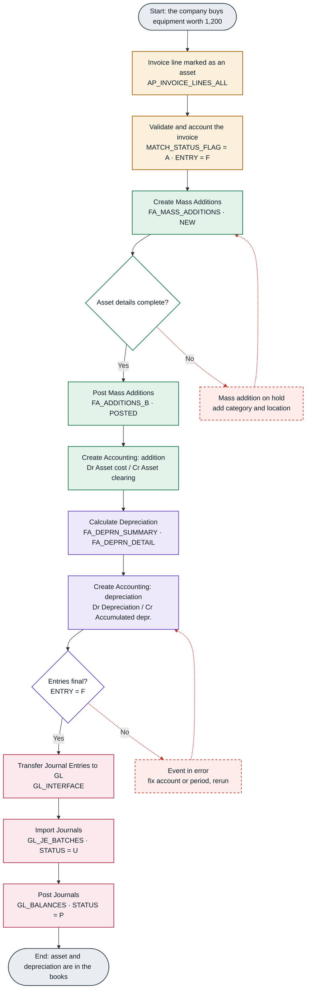

# Fixed Assets to GL

**What this flow covers:** the company buys something it will use for years, it is set up as an asset, loses value month by month (depreciation), and every step reaches the books.

**Modules involved:** Payables, Fixed Assets, Subledger Accounting (SLA), General Ledger (GL).

**Example used:** the company buys equipment worth 1,200.

Read the flowchart top to bottom. A diamond is a yes or no question. A "No" follows the dashed red path to a fix, then back to retry the step.

**Colors:** 🟨 Payables  🟩 Fixed Assets  🟪 Depreciation  🟥 General Ledger

## The steps in plain English

| # | What happens | Fusion job or screen | Main tables | Done when |
|---|---|---|---|---|
| 1 | A supplier invoice line is marked as an asset | Create Invoice | `AP_INVOICE_LINES_ALL` | Line flagged to track as asset |
| 2 | The invoice is validated and accounted | Validate Payables Invoice, Create Accounting | `AP_INVOICES_ALL`, `XLA_AE_LINES` | `MATCH_STATUS_FLAG = A`, entry `F` |
| 3 | Fixed Assets picks up the invoice line | Create Mass Additions | `FA_MASS_ADDITIONS` | Posting status `NEW` |
| 4 | Someone reviews and completes the asset details | Prepare Mass Additions | `FA_MASS_ADDITIONS` | Posting status `POST` (ready) |
| 5 | The asset is created | Post Mass Additions | `FA_ADDITIONS_B`, `FA_BOOKS` | Posting status `POSTED` |
| 6 | The addition is accounted | Create Accounting | `XLA_AE_HEADERS`, `XLA_AE_LINES` | Entry status `F` (final) |
| 7 | Depreciation is calculated for the month | Calculate Depreciation | `FA_DEPRN_SUMMARY`, `FA_DEPRN_DETAIL` | Depreciation run completed |
| 8 | Depreciation is accounted | Create Accounting | `XLA_AE_HEADERS`, `XLA_AE_LINES` | Entry status `F` (final) |
| 9 | Entries go to the ledger | Transfer Journal Entries to GL | `GL_INTERFACE` | Transfer status `Y` |
| 10 | Journals are created and posted | Import Journals, Post Journals | `GL_JE_BATCHES`, `GL_JE_LINES`, `GL_BALANCES` | Batch status `P` (posted) |

## The accounting entries

| Event | Debit | Credit |
|---|---|---|
| Invoice | Asset clearing 1,200 | Payables liability 1,200 |
| Asset addition | Asset cost 1,200 | Asset clearing 1,200 |
| Monthly depreciation | Depreciation expense (the month's share) | Accumulated depreciation (the month's share) |

The clearing account is a temporary holding account. The invoice fills it and the asset addition empties it. Depreciation repeats every month for the life of the asset.

## Where it usually gets stuck

- **Invoice never becomes an asset:** the line was not marked to track as an asset, or the invoice is not accounted yet.
- **Mass addition stuck on hold:** the category, location or other required details are missing.
- **No depreciation:** the asset is not in a depreciating state, or the asset period is closed.
- **Nothing in the ledger:** an accounting event is in error, or the transfer status is still `N`.

## Accuracy note

Job names, table names, column names and status codes are written from working knowledge of Oracle Fusion. They have not been checked against Oracle's documentation or a real environment. How invoice lines reach Fixed Assets (steps 1 to 3) is the part I am least sure about, so verify it first.

[Back to all flows](../README.md)
