# Order to Cash

**What this flow covers:** a customer orders goods, the company ships them, bills the customer, collects the money, and everything lands in the books.

**Modules involved:** Order Management, Shipping and Inventory, Receivables, Cost accounting, Subledger Accounting (SLA), General Ledger (GL).

**Example used:** a customer orders goods and is invoiced 1,500.

Read the flowchart top to bottom. A diamond is a yes or no question. A "No" follows the dashed red path to a fix, then back to retry the step.

**Colors:** 🟦 Order + Shipping  🟨 Billing  🟩 Receipts  🟥 General Ledger

```mermaid
flowchart TD
  n_s(["Start: a customer orders goods worth 1,500"]):::term
  n_ord["Sales order entered and submitted<br/>DOO_HEADERS_ALL · DOO_LINES_ALL"]:::c1
  n_dord{"Order accepted?"}:::d1
  n_dord_b["Order on hold<br/>fix and resubmit"]:::fail
  n_ship["Pick, pack and ship<br/>WSH_NEW_DELIVERIES · ship confirmed"]:::c1
  n_acs["Create Accounting: shipment cost<br/>Dr Cost of goods sold / Cr Inventory"]:::c1
  n_ai["Import AutoInvoice<br/>RA_INTERFACE_LINES_ALL"]:::c3
  n_dai{"AutoInvoice accepted?"}:::d3
  n_dai_b["Rows rejected<br/>RA_INTERFACE_ERRORS_ALL"]:::fail
  n_trx["Receivables invoice created<br/>RA_CUSTOMER_TRX_ALL · COMPLETE_FLAG = Y"]:::c3
  n_aci["Create Accounting: invoice<br/>Dr Receivables 1,500 / Cr Revenue 1,500"]:::c3
  n_rec["Customer pays: receipt created<br/>AR_CASH_RECEIPTS_ALL"]:::c2
  n_app["Receipt applied to the invoice<br/>AR_RECEIVABLE_APPLICATIONS_ALL"]:::c2
  n_dpd{"Invoice fully paid?<br/>AR_PAYMENT_SCHEDULES_ALL: CL"}:::d2
  n_dpd_b["Part paid<br/>apply more cash or follow up"]:::fail
  n_acr["Create Accounting: receipt<br/>Dr Cash 1,500 / Cr Receivables 1,500"]:::c2
  n_xfer["Transfer Journal Entries to GL<br/>GL_INTERFACE"]:::c5
  n_impj["Import Journals<br/>GL_JE_BATCHES · STATUS = U"]:::c5
  n_post["Post Journals<br/>GL_BALANCES · STATUS = P"]:::c5
  n_e(["End: the sale and the cash are in the books"]):::term
  n_s --> n_ord
  n_ord --> n_dord
  n_dord -- Yes --> n_ship
  n_ship --> n_acs
  n_acs --> n_ai
  n_ai --> n_dai
  n_dai -- Yes --> n_trx
  n_trx --> n_aci
  n_aci --> n_rec
  n_rec --> n_app
  n_app --> n_dpd
  n_dpd -- Yes --> n_acr
  n_acr --> n_xfer
  n_xfer --> n_impj
  n_impj --> n_post
  n_post --> n_e
  n_dord -. No .-> n_dord_b
  n_dord_b -.-> n_ord
  n_dai -. No .-> n_dai_b
  n_dai_b -.-> n_ai
  n_dpd -. No .-> n_dpd_b
  n_dpd_b -.-> n_app

  classDef term fill:#e9edf2,stroke:#33414f,stroke-width:1.5px,color:#121c27
  classDef fail fill:#fdecea,stroke:#c0392b,stroke-width:1.5px,stroke-dasharray:5 4,color:#121c27
  classDef c1 fill:#e5f1f6,stroke:#1d6f8e,stroke-width:1.6px,color:#121c27
  classDef d1 fill:#ffffff,stroke:#1d6f8e,stroke-width:1.6px,color:#121c27
  classDef a1 fill:#e5f1f6,stroke:#1d6f8e,stroke-width:1.5px,stroke-dasharray:5 4,color:#121c27
  classDef c2 fill:#e3f3ea,stroke:#1f7a52,stroke-width:1.6px,color:#121c27
  classDef d2 fill:#ffffff,stroke:#1f7a52,stroke-width:1.6px,color:#121c27
  classDef a2 fill:#e3f3ea,stroke:#1f7a52,stroke-width:1.5px,stroke-dasharray:5 4,color:#121c27
  classDef c3 fill:#fbf0dc,stroke:#a8660b,stroke-width:1.6px,color:#121c27
  classDef d3 fill:#ffffff,stroke:#a8660b,stroke-width:1.6px,color:#121c27
  classDef a3 fill:#fbf0dc,stroke:#a8660b,stroke-width:1.5px,stroke-dasharray:5 4,color:#121c27
  classDef c5 fill:#fbe9ed,stroke:#b23a52,stroke-width:1.6px,color:#121c27
  classDef d5 fill:#ffffff,stroke:#b23a52,stroke-width:1.6px,color:#121c27
  classDef a5 fill:#fbe9ed,stroke:#b23a52,stroke-width:1.5px,stroke-dasharray:5 4,color:#121c27
  linkStyle 16,17,18,19,20,21 stroke:#c0392b,stroke-width:1.6px
```

## The steps in plain English

| # | What happens | Fusion job or screen | Main tables | Done when |
|---|---|---|---|---|
| 1 | The sales order is entered and submitted | Order Management | `DOO_HEADERS_ALL`, `DOO_LINES_ALL` | Order moves past `DRAFT` |
| 2 | The goods are picked, packed and shipped | Shipping, Ship Confirm | `WSH_NEW_DELIVERIES` | Delivery is ship confirmed |
| 3 | The cost of the goods shipped is accounted | Create Accounting | `XLA_EVENTS`, `XLA_AE_HEADERS`, `XLA_AE_LINES` | Entry status `F` (final) |
| 4 | The shipped order is sent to billing | Import AutoInvoice | `RA_INTERFACE_LINES_ALL`, `RA_INTERFACE_ERRORS_ALL` | Interface rows processed |
| 5 | Receivables creates the invoice | AutoInvoice, Manage Transactions | `RA_CUSTOMER_TRX_ALL`, `RA_CUSTOMER_TRX_LINES_ALL`, `RA_CUST_TRX_LINE_GL_DIST_ALL` | Invoice `COMPLETE_FLAG = Y` |
| 6 | The invoice is accounted (the customer now owes the money) | Create Accounting | `XLA_AE_HEADERS`, `XLA_AE_LINES` | Entry status `F` (final) |
| 7 | The customer pays and a receipt is created | Create Receipt | `AR_CASH_RECEIPTS_ALL` | Receipt created and confirmed |
| 8 | The receipt is applied to the invoice | Apply Receipt | `AR_RECEIVABLE_APPLICATIONS_ALL`, `AR_PAYMENT_SCHEDULES_ALL` | Invoice status `CL` (closed) |
| 9 | The receipt is accounted | Create Accounting | `XLA_AE_HEADERS`, `XLA_AE_LINES` | Entry status `F` (final) |
| 10 | Entries go to the ledger | Transfer Journal Entries to GL | `GL_INTERFACE` | Transfer status `Y` |
| 11 | Journals are created and posted | Import Journals, Post Journals | `GL_JE_BATCHES`, `GL_JE_LINES`, `GL_BALANCES` | Batch status `P` (posted) |

## The accounting entries

| Event | Debit | Credit |
|---|---|---|
| Goods shipped | Cost of goods sold | Inventory |
| Invoice | Receivables 1,500 | Revenue 1,500 |
| Receipt | Cash 1,500 | Receivables 1,500 |

The cost entry uses the item's cost, not the selling price, so its amount is different from 1,500. After the receipt, Receivables is back to zero for this sale.

## Where it usually gets stuck

- **Order not shipping:** the order is on hold, or there is no stock to pick.
- **No invoice after shipping:** AutoInvoice rejected the rows. Look in `RA_INTERFACE_ERRORS_ALL`.
- **Invoice stays open:** the receipt was not applied, or only part was paid. Check `AR_PAYMENT_SCHEDULES_ALL` for status `OP` (open).
- **Nothing in the ledger:** an accounting event is in error, or the transfer status is still `N`.

## Accuracy note

Job names, table names, column names and status codes are written from working knowledge of Oracle Fusion. They have not been checked against Oracle's documentation or a real environment. The Order Management and shipping steps are the ones I am least sure about, so verify those first.

[Back to all flows](../README.md)
