# Procure to Pay

**What this flow covers:** the company needs something, orders it from a supplier, receives it, gets the supplier's bill, pays it, and everything lands in the books.

**Modules involved:** Purchasing (Self Service Procurement and Purchasing), Receiving, Payables, Payments, Subledger Accounting (SLA), General Ledger (GL).

**Example used:** the company buys goods worth 1,000.

Read the flowchart top to bottom. A diamond is a yes or no question. A "No" follows the dashed red path to a fix, then back to retry the step.

**Colors:** 🟦 Purchasing  🟩 Receiving  🟨 Payables  🟪 Payments + SLA  🟥 General Ledger

```mermaid
flowchart TD
  n_s(["Start: the company needs goods worth 1,000"]):::term
  n_req["Create purchase requisition<br/>POR_REQUISITION_HEADERS_ALL"]:::c1
  n_dreq{"Requisition approved?"}:::d1
  n_dreq_b["Returned to requester<br/>edit and resubmit"]:::fail
  n_po["Process into a purchase order<br/>PO_HEADERS_ALL · PO_LINES_ALL"]:::c1
  n_dpo{"Purchase order approved?"}:::d1
  n_dpo_b["Returned to buyer<br/>fix and resubmit"]:::fail
  n_send["Purchase order sent to supplier<br/>PO_HEADERS_ALL · STATUS = OPEN"]:::c1
  n_rcv["Goods received<br/>RCV_SHIPMENT_HEADERS · RCV_TRANSACTIONS"]:::c2
  n_accr["Create Accounting: receipt<br/>Dr Inventory / Cr Receipt accrual"]:::c2
  n_inv["Invoice entered, matched to PO<br/>AP_INVOICES_ALL · AP_INVOICE_LINES_ALL"]:::c3
  n_val["Validate Payables Invoice<br/>MATCH_STATUS_FLAG"]:::c3
  n_hold{"Match ok, no holds?"}:::d3
  n_hold_b["Hold placed<br/>AP_HOLDS_ALL: fix price or qty"]:::fail
  n_acc1["Create Accounting: invoice<br/>Dr Receipt accrual / Cr Liability"]:::c4
  n_pay["Payment Process Request<br/>IBY_PAYMENTS_ALL · ISSUED"]:::c4
  n_acc2["Create Accounting: payment<br/>Dr Liability / Cr Cash"]:::c4
  n_fin{"Entries final?<br/>ENTRY = F"}:::d4
  n_fin_b["Event in error<br/>fix account or period, rerun"]:::fail
  n_xfer["Transfer Journal Entries to GL<br/>GL_INTERFACE"]:::c5
  n_impj["Import Journals<br/>GL_JE_BATCHES · STATUS = U"]:::c5
  n_post["Post Journals<br/>GL_BALANCES · STATUS = P"]:::c5
  n_e(["End: the purchase is in the books"]):::term
  n_s --> n_req
  n_req --> n_dreq
  n_dreq -- Yes --> n_po
  n_po --> n_dpo
  n_dpo -- Yes --> n_send
  n_send --> n_rcv
  n_rcv --> n_accr
  n_accr --> n_inv
  n_inv --> n_val
  n_val --> n_hold
  n_hold -- Yes --> n_acc1
  n_acc1 --> n_pay
  n_pay --> n_acc2
  n_acc2 --> n_fin
  n_fin -- Yes --> n_xfer
  n_xfer --> n_impj
  n_impj --> n_post
  n_post --> n_e
  n_dreq -. No .-> n_dreq_b
  n_dreq_b -.-> n_req
  n_dpo -. No .-> n_dpo_b
  n_dpo_b -.-> n_po
  n_hold -. No .-> n_hold_b
  n_hold_b -.-> n_val
  n_fin -. No .-> n_fin_b
  n_fin_b -.-> n_acc2

  classDef term fill:#e9edf2,stroke:#33414f,stroke-width:1.5px,color:#121c27
  classDef fail fill:#fdecea,stroke:#c0392b,stroke-width:1.5px,stroke-dasharray:5 4,color:#121c27
  classDef c1 fill:#e5f1f6,stroke:#1d6f8e,stroke-width:1.6px,color:#121c27
  classDef d1 fill:#ffffff,stroke:#1d6f8e,stroke-width:1.6px,color:#121c27
  classDef a1 fill:#e5f1f6,stroke:#1d6f8e,stroke-width:1.5px,stroke-dasharray:5 4,color:#121c27
  classDef c2 fill:#e3f3ea,stroke:#1f7a52,stroke-width:1.6px,color:#121c27
  classDef d2 fill:#ffffff,stroke:#1f7a52,stroke-width:1.6px,color:#121c27
  classDef a2 fill:#e3f3ea,stroke:#1f7a52,stroke-width:1.5px,stroke-dasharray:5 4,color:#121c27
  classDef c3 fill:#fbf0dc,stroke:#a8660b,stroke-width:1.6px,color:#121c27
  classDef d3 fill:#ffffff,stroke:#a8660b,stroke-width:1.6px,color:#121c27
  classDef a3 fill:#fbf0dc,stroke:#a8660b,stroke-width:1.5px,stroke-dasharray:5 4,color:#121c27
  classDef c4 fill:#eee9fa,stroke:#6a4cc0,stroke-width:1.6px,color:#121c27
  classDef d4 fill:#ffffff,stroke:#6a4cc0,stroke-width:1.6px,color:#121c27
  classDef a4 fill:#eee9fa,stroke:#6a4cc0,stroke-width:1.5px,stroke-dasharray:5 4,color:#121c27
  classDef c5 fill:#fbe9ed,stroke:#b23a52,stroke-width:1.6px,color:#121c27
  classDef d5 fill:#ffffff,stroke:#b23a52,stroke-width:1.6px,color:#121c27
  classDef a5 fill:#fbe9ed,stroke:#b23a52,stroke-width:1.5px,stroke-dasharray:5 4,color:#121c27
  linkStyle 18,19,20,21,22,23,24,25 stroke:#c0392b,stroke-width:1.6px
```

## The steps in plain English

| # | What happens | Fusion job or screen | Main tables | Done when |
|---|---|---|---|---|
| 1 | Someone asks to buy goods | Create Requisition | `POR_REQUISITION_HEADERS_ALL`, `POR_REQUISITION_LINES_ALL` | Status `APPROVED` after approval |
| 2 | The requisition becomes a purchase order | Process Requisitions | `PO_HEADERS_ALL`, `PO_LINES_ALL`, `PO_LINE_LOCATIONS_ALL`, `PO_DISTRIBUTIONS_ALL` | Order status `OPEN` after approval |
| 3 | The order goes to the supplier | Communicate purchase order | `PO_HEADERS_ALL` | Order communicated |
| 4 | The goods arrive and are received | Receiving, Manage Receipts | `RCV_SHIPMENT_HEADERS`, `RCV_TRANSACTIONS` | Receipt transaction created |
| 5 | The receipt is accounted (the company now owes for goods received) | Create Accounting | `XLA_EVENTS`, `XLA_AE_HEADERS`, `XLA_AE_LINES` | Entry status `F` (final) |
| 6 | The supplier's invoice is entered and matched to the order | Create Invoice (match to PO) | `AP_INVOICES_ALL`, `AP_INVOICE_LINES_ALL` | Lines carry the PO reference |
| 7 | The invoice is checked | Validate Payables Invoice | `AP_INVOICES_ALL`, `AP_HOLDS_ALL` | `MATCH_STATUS_FLAG = A`, no holds |
| 8 | The invoice becomes an accounting entry | Create Accounting | `XLA_AE_HEADERS`, `XLA_AE_LINES` | Entry status `F` (final) |
| 9 | The supplier is paid | Payment Process Request | `IBY_PAYMENTS_ALL`, `AP_CHECKS_ALL` | Payment status `ISSUED` |
| 10 | The payment becomes an accounting entry | Create Accounting | `XLA_AE_HEADERS`, `XLA_AE_LINES` | Entry status `F` (final) |
| 11 | Entries go to the ledger | Transfer Journal Entries to GL | `GL_INTERFACE` | Transfer status `Y` |
| 12 | Journals are created and posted | Import Journals, Post Journals | `GL_JE_BATCHES`, `GL_JE_LINES`, `GL_BALANCES` | Batch status `P` (posted) |

## The accounting entries

| Event | Debit | Credit |
|---|---|---|
| Goods received | Inventory (or Expense) 1,000 | Receipt accrual 1,000 |
| Invoice | Receipt accrual 1,000 | Payables liability 1,000 |
| Payment | Payables liability 1,000 | Cash 1,000 |

The receipt accrual account is a temporary holding account. It is filled when the goods arrive and cleared when the invoice is accounted, so it ends at zero.

## Why matching matters

Payables compares the invoice to the purchase order (and the receipt, in a three-way match). If the quantity or price is off by more than the allowed tolerance, a hold is placed and the invoice cannot be paid until it is fixed or released.

## Where it usually gets stuck

- **Requisition not turning into an order:** it is not approved yet, or the buyer has not processed it.
- **Invoice on hold:** the invoice price or quantity does not match the order or the receipt.
- **Receipt not accounted:** the receipt accounting event is in error, often a missing account.
- **Nothing in the ledger:** the transfer status is still `N`, or the period is closed.

## Accuracy note

Job names, table names, column names and status codes are written from working knowledge of Oracle Fusion. They have not been checked against Oracle's documentation or a real environment. Receipt accounting is the area I am least sure about, so verify those step names first.

[Back to all flows](../README.md)
