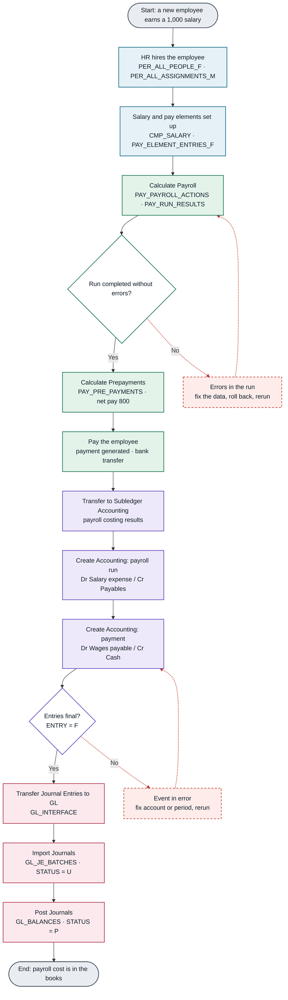

# Hire to Retire: Payroll to GL

**What this flow covers:** a person is hired, set up to be paid, paid through a payroll run, and the cost of that payroll reaches the General Ledger. When someone leaves the company, their final pay goes through the same flow.

**Modules involved:** HCM (Core HR), Payroll, Costing, Subledger Accounting (SLA), General Ledger (GL).

**Example used:** an employee earns a gross salary of 1,000. Taxes of 200 are withheld, so the net pay is 800.

Read the flowchart top to bottom. A diamond is a yes or no question. A "No" follows the dashed red path to a fix, then back to retry the step.

**Colors:** 🟦 HCM  🟩 Payroll  🟪 Costing + SLA  🟥 General Ledger

## The steps in plain English

| # | What happens | Fusion job or screen | Main tables | Done when |
|---|---|---|---|---|
| 1 | HR hires the person | Hire an Employee | `PER_ALL_PEOPLE_F`, `PER_ALL_ASSIGNMENTS_M` | Assignment is `ACTIVE` |
| 2 | Salary and pay elements are set up | Manage Salary, Manage Element Entries | `CMP_SALARY`, `PAY_ELEMENT_ENTRIES_F` | Salary and elements exist for the pay period |
| 3 | The payroll is calculated | Calculate Payroll | `PAY_PAYROLL_ACTIONS`, `PAY_PAYROLL_REL_ACTIONS`, `PAY_RUN_RESULTS` | Run completed with no errors |
| 4 | Net pay is worked out for each person | Calculate Prepayments | `PAY_PRE_PAYMENTS` | Prepayment created |
| 5 | The employee is paid | Generate payments | Payment tables, bank file | Payment generated |
| 6 | The costs are sent to accounting | Transfer to Subledger Accounting | Payroll costing results | Costing transferred |
| 7 | The payroll run is accounted | Create Accounting | `XLA_EVENTS`, `XLA_AE_HEADERS`, `XLA_AE_LINES` | Entry status `F` (final) |
| 8 | The payment is accounted | Create Accounting | `XLA_AE_HEADERS`, `XLA_AE_LINES` | Entry status `F` (final) |
| 9 | Entries go to the ledger | Transfer Journal Entries to GL | `GL_INTERFACE` | Transfer status `Y` |
| 10 | Journals are created and posted | Import Journals, Post Journals | `GL_JE_BATCHES`, `GL_JE_LINES`, `GL_BALANCES` | Batch status `P` (posted) |

## The accounting entries

| Event | Debit | Credit |
|---|---|---|
| Payroll run | Salary expense 1,000 | Wages payable 800, Tax withholding payable 200 |
| Payment to the employee | Wages payable 800 | Cash 800 |

After the payment, wages payable is back to zero. The 200 of tax stays as a liability until the company pays it to the tax authority.

## Why the costing step exists

Payroll results say what each person earned. Costing decides which accounts and cost centers those amounts belong to. It uses the costing setup on the person's job, department and element, and it must run before Create Accounting can create entries.

## Leaving the company

When an employee leaves, HR ends the assignment. The final pay, such as unpaid salary or leave payout, goes through the same steps: calculate payroll, prepay, pay, cost, account, and post.

## Where it usually gets stuck

- **Person not paid:** the assignment is not active, or the salary and payroll relationship are missing.
- **Payroll run has errors:** missing data such as tax details or bank details. Fix it, roll back the run, and rerun.
- **No accounting entries:** costing did not transfer, or an account in the costing setup is missing or invalid.
- **Nothing in the ledger:** the accounting event is in error, or the transfer status is still `N`.

## Accuracy note

Job names, table names, column names and status codes are written from working knowledge of Oracle Fusion. They have not been checked against Oracle's documentation or a real environment. Payroll is the area I am least sure about, especially the costing steps and the payment tables, so verify those first. Payroll also differs by country, so this shows a generic flow.

[Back to all flows](../README.md)
